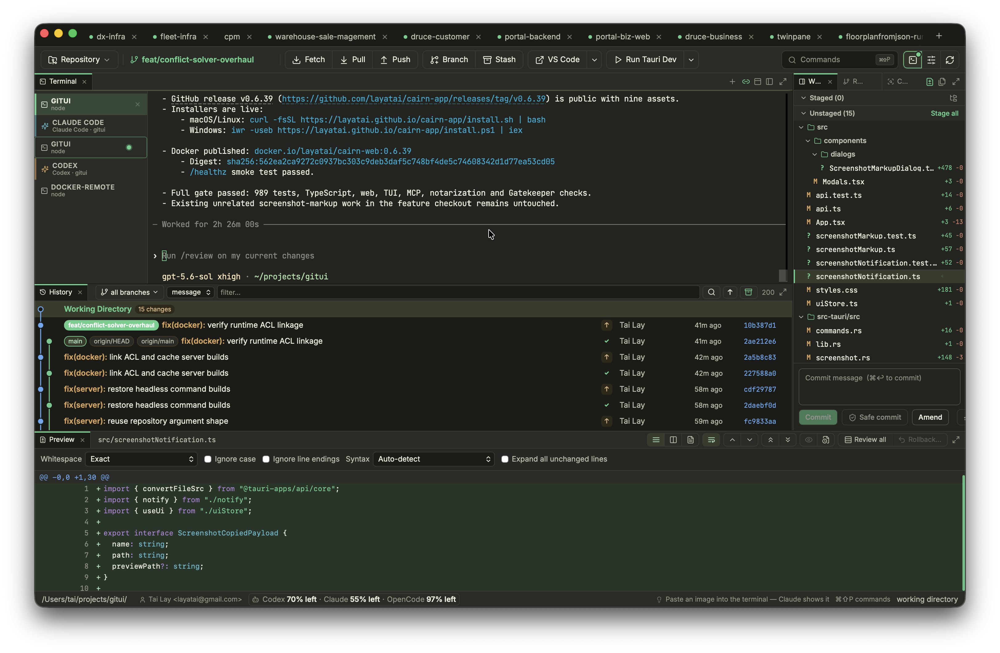
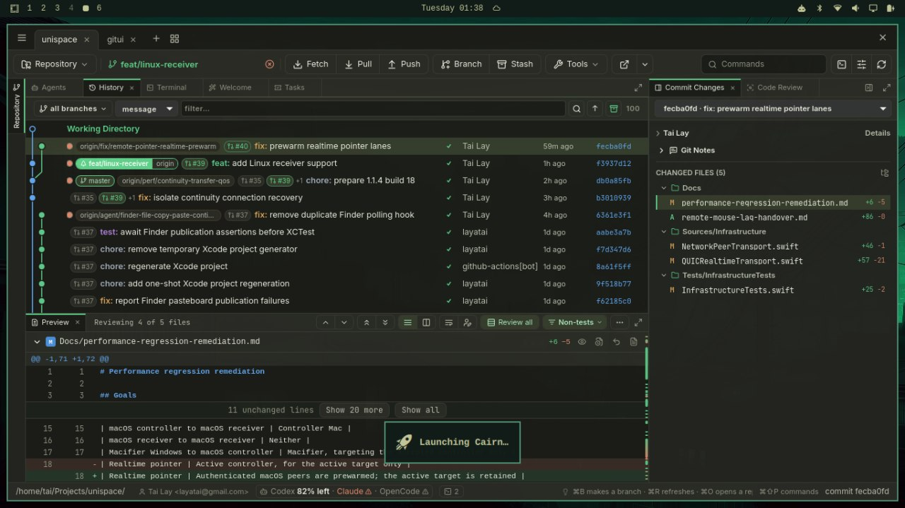
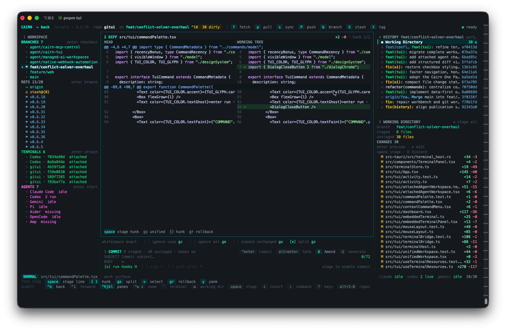
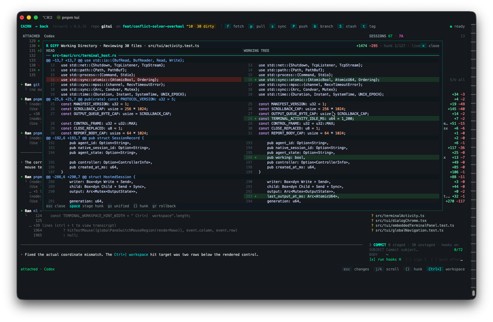
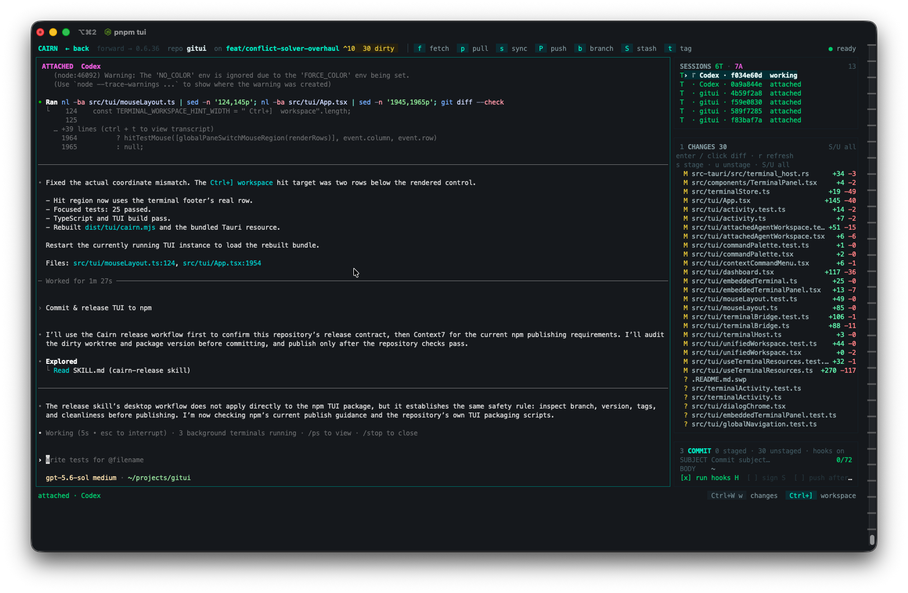

<h1 align="center">Cairn</h1>

<p align="center"><strong>A fast, cross-platform Git client with integrated terminals and AI coding-agent workflows.</strong></p>

<p align="center">
  <a href="https://github.com/layatai/cairn-app/releases/latest"><strong>Download latest</strong></a>
  · <a href="https://layatai.github.io/cairn-app/">Interactive tour</a>
  · <a href="https://github.com/layatai/cairn-app/releases">All releases</a>
</p>

Cairn combines a native desktop Git client, detachable terminal sessions, and
AI coding-agent workflows. It is built with Tauri 2, Rust/libgit2, React, and
TypeScript.

This repository publishes the desktop installers, standalone TUI packages,
Cairn Server packages, and the [Cairn website](https://layatai.github.io/cairn-app/).
A separate Linux AMD64 Docker image is published for the web UI; see below.

## Screenshots

### Desktop app — macOS



### Desktop app — Linux (Omarchy)



### Standalone TUI



| Attached diff review | Attached AI-agent session |
|---|---|
|  |  |

## Downloads

> **Recommended:** use the [latest release](https://github.com/layatai/cairn-app/releases/latest),
> published only after the complete desktop and TUI asset set passes release verification.

Asset names below match [v0.6.85](https://github.com/layatai/cairn-app/releases/tag/v0.6.85).

| Product | Platform | Release asset | Notes |
|---|---|---|---|
| Desktop app | macOS Apple Silicon | `Cairn_<version>_aarch64.dmg` | Signed, notarized, and stapled. App archive: `Cairn_aarch64.app.tar.gz` |
| Desktop app | macOS Intel | `Cairn_<version>_x64.dmg` | Signed, notarized, and stapled. App archive: `Cairn_x64.app.tar.gz` |
| Desktop app | Linux x64 | `Cairn_<version>_amd64.AppImage`, `Cairn_<version>_amd64.deb`, or `Cairn-<version>-1.x86_64.rpm` | |
| Desktop app | Linux ARM64 | `Cairn_<version>_aarch64.AppImage`, `Cairn_<version>_arm64.deb`, or `Cairn-<version>-1.aarch64.rpm` | |
| Desktop app | Windows x64 | `Cairn_<version>_x64-setup.exe` or `Cairn_<version>_x64_en-US.msi` | Unsigned. SmartScreen may warn |
| Desktop app | Windows ARM64 | `Cairn_<version>_arm64-setup.exe` or `Cairn_<version>_arm64_en-US.msi` | Unsigned. SmartScreen may warn |
| Standalone TUI | macOS | `cairn-tui-darwin-universal.tar.gz` | Universal binary |
| Standalone TUI | Linux | `cairn-tui-linux-x64.tar.gz` or `cairn-tui-linux-arm64.tar.gz` | Also supported in WSL2 |
| Standalone TUI | Windows | `cairn-tui-windows-x64.zip` or `cairn-tui-windows-arm64.zip` | Native terminal host included |
| Cairn Server | macOS | `cairn-server-darwin-universal.tar.gz` | Self-hosted web UI. Checksums in `cairn-server-checksums.txt` |
| Cairn Server | Linux x64 | `cairn-server-linux-x64.tar.gz` | Checksums in `cairn-server-checksums.txt` |
| Cairn Server | Linux ARM64 | `cairn-server-linux-arm64.tar.gz` | Checksums in `cairn-server-checksums.txt` |

## Install the desktop app

### macOS

1. Download the DMG for your Mac from the [latest release](https://github.com/layatai/cairn-app/releases/latest): `Cairn_<version>_aarch64.dmg` on Apple Silicon, or `Cairn_<version>_x64.dmg` on Intel.
2. Open it and drag **Cairn** into **Applications**.
3. Launch Cairn normally. These builds are signed and notarized by Apple.

### Linux

Download the AppImage, Debian package, or RPM for x64 or ARM64 from the
[latest release](https://github.com/layatai/cairn-app/releases/latest).

### Windows

Download the x64 or ARM64 setup executable or MSI from the
[latest release](https://github.com/layatai/cairn-app/releases/latest). The
Windows installers are not code-signed. If SmartScreen appears, choose
**More info → Run anyway**.

## Install the standalone TUI

The standalone TUI supports macOS, Linux, Windows, and WSL2 on x64 and ARM64.
The installers select the correct architecture, install a managed Node.js
runtime and Git when needed, verify release checksums, and are safe to rerun.

### macOS, Linux, or WSL2

```bash
curl -fsSL --proto '=https' --tlsv1.2 https://layatai.github.io/cairn-app/install.sh | bash
```

### Windows PowerShell

```powershell
iwr -useb https://layatai.github.io/cairn-app/install.ps1 | iex
```

Standalone package hashes are published in
[`cairn-tui-checksums.txt`](https://github.com/layatai/cairn-app/releases/latest/download/cairn-tui-checksums.txt).
Run `cairn` inside any Git repository. `Ctrl+]` detaches from a live session;
running `cairn` again reconnects to it.

## Cairn Server

The release includes self-hosted server tarballs with the web UI:

- macOS: `cairn-server-darwin-universal.tar.gz`
- Linux x64: `cairn-server-linux-x64.tar.gz`
- Linux ARM64: `cairn-server-linux-arm64.tar.gz`

Checksums are in
[`cairn-server-checksums.txt`](https://github.com/layatai/cairn-app/releases/latest/download/cairn-server-checksums.txt).
The [guide](https://layatai.github.io/cairn-app/guide.html#remote) describes
deploying Cairn Server over SSH to a Docker host.

## Run Cairn with Docker

Docker Hub publishes `layatai/cairn-web` for Linux AMD64. This page pins
`0.6.66`, the newest tag there at the time of the v0.6.85 site update. Docker
Hub has no `0.6.85` image. The image keeps repositories and user configuration
in named volumes and binds to localhost by default. The first start installs
the common agent CLI toolset and can take one or two minutes.

```bash
CAIRN_DOCKER_PASSWORD="$(openssl rand -hex 12)"
docker run -d \
  --name cairn \
  --restart unless-stopped \
  -p 127.0.0.1:8080:8080 \
  -e CAIRN_USER=cairn \
  -e CAIRN_PASS="$CAIRN_DOCKER_PASSWORD" \
  -v cairn-workspace:/workspace \
  -v cairn-home:/home/cairn \
  docker.io/layatai/cairn-web:0.6.66
printf 'Open http://127.0.0.1:8080 and sign in as cairn with password: %s\n' "$CAIRN_DOCKER_PASSWORD"
```

Use a TLS reverse proxy before exposing Cairn beyond localhost.

## Features

- Integrated terminal tabs for shells and AI coding agents such as Claude Code,
  Codex, Gemini, and OpenCode
- Resizable terminal session rail that automatically switches between compact
  and expanded layouts
- Standalone TUI with detachable sessions and native reconnect support
- AI-generated Conventional Commit messages from staged changes
- Commit graph with lane coloring, virtualized history, and message, author, and
  path filters
- Complete working-tree workflow: stage, unstage, discard, commit, and amend
- Branch, remote, tag, and stash management
- Fetch, pull, push, and clone through system Git authentication
- Diff viewer, blame, file history, interactive rebase, cherry-pick, revert,
  reset, merge, split, and reword
- History Rewrite Studio and stack-aware `.gitignore` generation
- Command palette, configurable themes and density, and English/Vietnamese UI

## Integrity

- GitHub records a SHA-256 digest on each release asset. Use the digest shown
  on the release page to check a download.
- Standalone TUI checksums ship in `cairn-tui-checksums.txt` and are verified
  by the installation scripts.
- Cairn Server checksums ship in `cairn-server-checksums.txt`.

---

© Cairn. macOS builds are signed and notarized.
